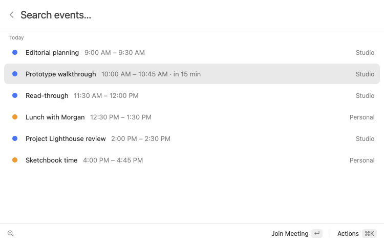

# Lumen

**Open apps, files and everyday tools from your keyboard.**

[](LICENSE) [](#requirements-and-optional-integrations)

Lumen is a native macOS launcher. Open a file, arrange your windows, paste a saved clip, or find your next meeting from the same keyboard-driven panel.

- Search apps, files, commands, and clipboard history.
- Tile windows, move them between displays, and jump straight to an open window.
- Show and join meetings with macOS Calendar access.

## Quick start

Download the ZIP from [GitHub Releases](https://github.com/jsc2304/lumen-app/releases/latest), extract it and move Lumen to Applications. The app is signed ad hoc. On first launch, macOS may require you to approve Lumen individually under **System Settings → Privacy & Security**. See [Apple’s instructions](https://support.apple.com/en-us/102445).

### Build from source

On macOS 26 or later with Xcode Command Line Tools installed, run:

```sh
./build.sh
```

The script runs the self-checks, replaces any existing `~/Applications/Lumen.app`, and starts Lumen. Open its menu bar icon and choose **Open Lumen**, then type `10 km in mi` to try the calculator. You can configure launcher shortcuts in **Settings → General → Launcher Hotkeys**.



*My Schedule in Lumen 0.3.0 with fictional calendar data.*

## Features

| Feature | What you can do |
|---|---|
| Launcher and actions | Search apps, files, commands and shortcuts. Press ⌘K to see actions for a result. Favorite a command or give it an alias or global hotkey. |
| Window management | Snap the front window to halves, thirds, quarters or sixths. Use **Cycle Left** or **Cycle Right** to step through widths, **Tile Visible Windows** to arrange windows in columns, and **Next Display** to move a window to another monitor. Center, maximize or restore a window, or jump to an open one with **Switch Windows**. |
| Clipboard and snippets | Search and preview copied text and images, pin frequently used clips, and paste clips in sequence. Create snippets that expand when you type an abbreviation. |
| Quicklinks and automation | Open bookmarked destinations and parameterized web searches. Run your own script commands, trigger Apple Shortcuts, and search the frontmost app’s menu commands. |
| Notes and focus | Open a floating note, create and search notes, and start, pause or finish focus sessions. |
| Search and lookup | Find files and screenshots, paste the latest screenshot, look up contacts or definitions, translate text, and calculate units, currencies, time zones or dates. |
| Calendar and work | Browse recent and upcoming events, join calls and create calendar events. Optional integrations surface GitHub pull requests, issues and notifications, and book time via the mite CLI. |
| AI | Press Tab to ask about a search query, continue in a chat, or run an AI command on selected text. Attach screenshots when you choose. Requires a configured provider or the Codex CLI. |

Window commands, menu search and snippet expansion use macOS Accessibility permission.

## Requirements and optional integrations

Lumen builds with the Swift compiler included in Xcode Command Line Tools. Grant macOS permissions when you first use a feature that needs them. Calendar access enables My Schedule. Accessibility enables window commands, selected text and snippets.

GitHub uses a signed-in `gh` CLI. Time booking uses a configured `mite` CLI and asks you to confirm before submitting. AI is off until you enable it in Settings. It uses your configured provider, local server or signed-in Codex CLI. Your provider may charge your account. These integrations are optional.

Use `./check.sh` to run the self-checks, or `./build.sh --build-only` to produce `build/Lumen.app` for local testing. For source updates, pull the updated source and rerun `./build.sh`.

Release builds offer **Check for Updates…** in the Lumen menu. Lumen checks public GitHub Releases and verifies the update signature before installation. A local source build needs release-channel configuration to use this flow.

## Usage

Use the configured launcher hotkey to open search. Press Return to run the selected result or ⌘K to see its actions. Press Escape to go back or dismiss the panel.

## Data and privacy

- **Stays on this Mac**, in `~/Library/Application Support/Lumen`, unencrypted: usage ranking, favorites,
  aliases and hotkeys, clipboard history with images and copies of new screenshots, snippets, quicklinks,
  calculator history, notes, AI chats (including attached screenshots), your AI commands, focus sessions and
  auto-quit rules, the GitHub, script and shortcut caches, and which mite project a meeting title was booked to. Copies that
  password managers mark as concealed or transient are never stored. Settings → Clear Clipboard History
  deletes the history.
- AI chats are kept until you delete them with **Delete Chat**. Creating a new chat keeps older conversations.
- **Leaves the Mac** only for these features:
  - AI: the question, the selected text, chat messages and screenshots you send go to the configured provider;
    Translate sends text to AI only after you explicitly choose the AI translation action. Claude: `api.anthropic.com`,
    model `claude-opus-5-5` by default, low effort, server-side refusal fallback. OpenAI-compatible: the base URL you set.
    ChatGPT subscription: the Codex CLI sends it to OpenAI under your ChatGPT account (read-only, no session files kept).
  - Quicklinks and web searches: the query goes to the website you choose, opened in your browser.
  - Currency rates: once a day from the European Central Bank (`ecb.europa.eu`), no personal data.
  - GitHub: read through your `gh` login; the only write is "Mark as Read" on a notification.
  - mite: entries you confirm are booked through your `mite` CLI.
  - Updates: a release build contacts GitHub for the feed and downloads the update you choose to install.
- API keys are stored in the macOS Keychain (service `com.jan.lumen`); GitHub and mite use their own CLI logins.

## Feedback and license

Report bugs in GitHub Issues. See [SECURITY.md](SECURITY.md) for private vulnerability reporting.

Lumen is licensed under the [MIT License](LICENSE).
